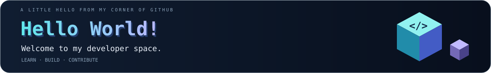
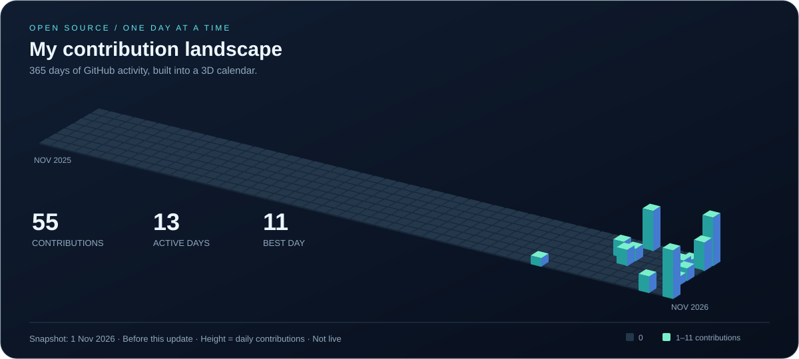
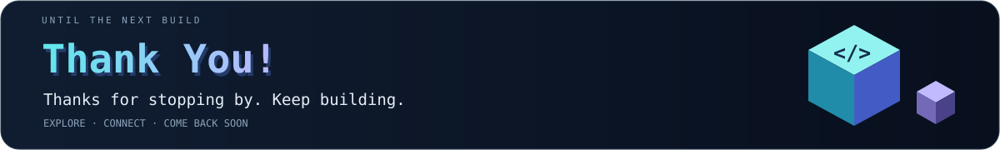

 

**Curious mind. Practical projects. A long-term commitment to craft.**

Engineering undergraduate · Web applications · Open-source exploration

[Explore projects](#selected-work) · [Open source](#open-source) · [GitHub activity](#github-activity)

---

## Behind the build

I'm **Gontu Sujith Reddy**, an engineering undergraduate building practical web applications and exploring open source. My projects focus on everyday needs: sharing community resources, managing inventory, and understanding traffic.

<table>
<tr><td width="50%" valign="top"><h3>🔨 What I build</h3>
Practical web applications shaped around everyday needs, from community resource sharing to inventory workflows.
</td><td width="50%" valign="top"><h3>🌱 What I am learning</h3>
C, data structures and algorithms, Linux, Shell scripting, debugging, and automated tests.
</td></tr>
<tr><td width="50%" valign="top"><h3>🔍 What I explore</h3>
How mature open-source projects are tested, reviewed, and improved through thoughtful collaboration.
</td><td width="50%" valign="top"><h3>🧭 Where I am headed</h3>
Strong fundamentals, dependable software, and a developer career built through consistent learning.
</td></tr>
</table>

## 🚀 Selected work

<table>
<tr>
<td width="50%" valign="top">
<h3>01 / ResourceBridge</h3>

A community platform connecting resource owners with people who need spaces, gadgets, learning materials, and other shared assets.

<code>Community</code> <code>Resource sharing</code> <code>TypeScript</code>

<a href="https://github.com/GontuSujithReddy/Codeathon"><b>Explore repository →</b></a>
</td>
<td width="50%" valign="top">
<h3>02 / StockSense</h3>

Inventory management with transparent stock signals and practical workflows for keeping business operations organized.

<code>Inventory</code> <code>Operations</code> <code>TypeScript</code>

<a href="https://github.com/GontuSujithReddy/stocksense"><b>Explore repository →</b></a>
</td>
</tr>
<tr>
<td width="50%" valign="top">
<h3>03 / TrafficGuard AI</h3>

An AI-powered traffic congestion prediction agent exploring technology for smarter mobility.

<code>AI exploration</code> <code>Mobility</code> <code>HTML</code>

<a href="https://github.com/GontuSujithReddy/TrafficGuard-AI"><b>Explore repository →</b></a>
</td>
<td width="50%" valign="top">
<h3>04 / Open-source journey</h3>

Learning through real codebases, reproducible bugs, tests, and maintainer feedback. Currently exploring Git's C codebase and contribution process.

<code>C</code> <code>Git</code> <code>Testing</code>

<a href="https://github.com/git/git/pull/2465"><b>View contribution →</b></a>
</td>
</tr>
</table>

## 🧰 Skills & toolkit

**Languages used across my projects**

**Development environment & growing foundations**

Actively developing: C programming · DSA · Shell scripting · debugging · automated tests · code review.

## 🌐 Open source

**Git — sequencer / fixup behavior**

Submitted a pull request addressing fixups when their target was not applied. This is part of my ongoing learning in systems programming and collaborative development.

[Git pull request #2465](https://github.com/git/git/pull/2465) · [GitGitGadget submission #2277](https://github.com/gitgitgadget/git/pull/2277) · [All public pull requests](https://github.com/pulls?q=is%3Apr+author%3AGontuSujithReddy)

Contribution submissions · Follow the linked discussions for current review status.

## 📊 GitHub activity

Snapshot observed on 1 November 2026, before this design update · Counts are not live; see GitHub’s native activity below for current totals.

 

Blocks rise on a repeating loop · Click the graph to open the larger animation.

[View live contribution graph and activity on GitHub](https://github.com/GontuSujithReddy?tab=overview)

---

Explore a project, follow the journey, or share an idea.

[Repositories](https://github.com/GontuSujithReddy?tab=repositories) · [Pull requests](https://github.com/pulls?q=is%3Apr+author%3AGontuSujithReddy) · [ORCID](https://orcid.org/0009-0003-2506-3489)

 

